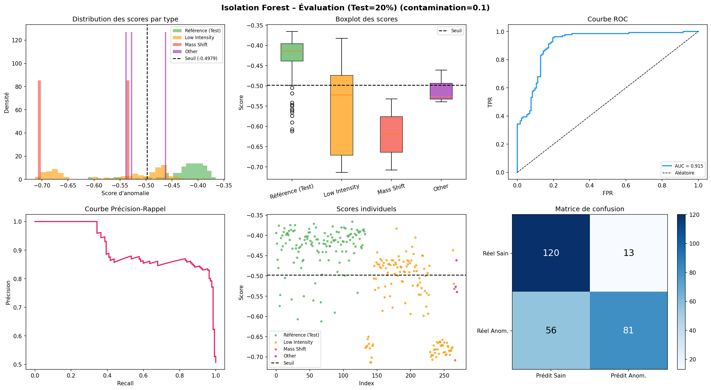

# Anomaly detection on mass spectrometry spectra (Isolation Forest)

Student project (Télécom SudParis, Jan–Jun 2026) carried out for Hôpital Foch, which analyses exhaled breath by mass spectrometry. The goal was to automatically detect faulty acquisitions (low intensity, mass shift, other defects) before analysis. The project was ranked among the top 12 out of 120.

This repository is a small selection of files from the project, chosen to illustrate my work. It is not representative of the full project. It only contains a non-final version of the Isolation Forest part: in the final system, this model was combined with two other detection methods in a meta-classifier, which is not published here. The code is shared with the agreement of our supervisor at Hôpital Foch.

## Method

- Spectra (CSV: `mz`, `spectrum`) are interpolated on a common m/z grid (0–500, step 0.01) and log-transformed.
- For each peak window, three features are computed: standard deviation, sum and skewness.
- Features are standardised, then an Isolation Forest (scikit-learn, 200 trees) is trained on the training split.
- The script evaluates the model on validation and test sets, writes a text report and exports the anomaly scores to JSON for the meta-classifier.

## Results (test set, Isolation Forest alone)

The figure below comes from an earlier run during the project and does not necessarily match the code in this repository. On that run, the AUC-ROC was 0.915: mass-shift anomalies were all detected, but part of the low-intensity ones were missed, hence the meta-classifier.



## Files

- `isolation_forest.py`: full pipeline
- `trace.py`, `trace_compare.py`: plot one or several spectra (log scale)
- `spectrum_example1.csv`, `spectrum_example2.csv`: synthetic spectra I generated, only to show the data format. They are not real data from the hospital, which is confidential and not included.

To run `isolation_forest.py`, the data must be placed in `backup_big_data/` (one sub-folder per class: `reference_spectrum`, `low_intensity`, `mass_shift`, `other`), with a peak window file `fenetres_4.txt` and a `split_manifest.json`.

```bash
pip install numpy pandas scipy scikit-learn matplotlib
python trace_compare.py
```

Comments and outputs in the code are in French.
